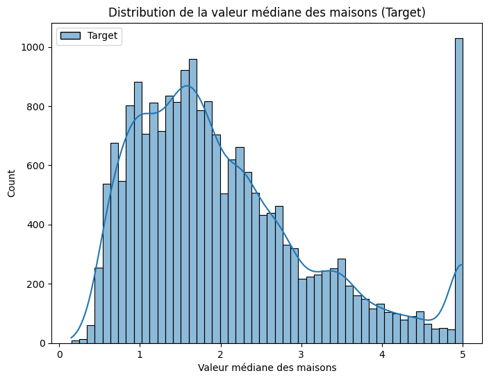
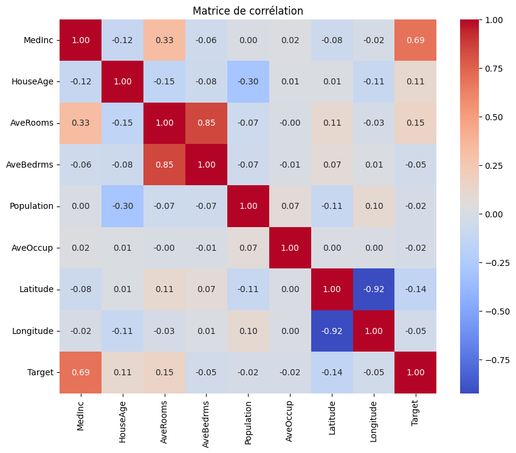
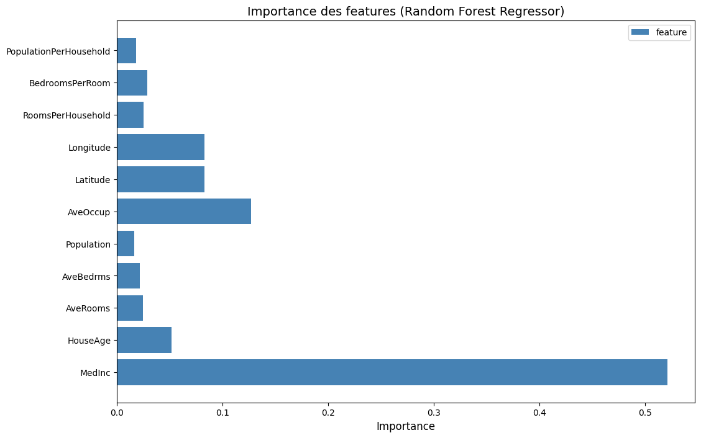

# California Housing

Pipeline de régression supervisée pour prédire la valeur médiane des maisons en Californie : feature engineering (pièces par ménage, chambres par pièce, population par ménage), comparaison des performances entre Régression Linéaire et Forêt Aléatoire via le RMSE, analyse et visualisation de l'importance des features pour identifier les variables les plus déterminantes dans la prédiction du prix immobilier.


## Données

- **Source** : `fetch_california_housing` (scikit-learn)
- **Cible** : Valeur médiane des maisons en centaines de milliers de dollars


## Modèles entraînés

L'étude s'est concentrée sur la comparaison entre un modèle de Régression Linéaire classique et une approche par Forêt Aléatoire. Ces modèles ont été évalués en mesurant l'erreur quadratique moyenne (RMSE) sur un jeu de test afin de valider leur capacité à prédire précisément les valeurs cibles.


## Meilleur modèle

Le meilleur modèle choisi pour la suite de l'étude est la Forêt Aléatoire suite à son meilleur score d'erreur quadratique.

## Résultats et visualisations

### Distribution de la cible



La distribution est asymétrique et comporte une concentration à 5, qui correspond au plafond des valeurs de la cible dans ce jeu de données. Les valeurs sont exprimées en centaines de milliers de dollars.

### Matrice de corrélation



La variable `MedInc` (revenu médian) présente la corrélation linéaire la plus marquée avec la cible (`Target`), avec une valeur d'environ 0,69. Cette corrélation décrit une association et ne suffit pas à établir une relation de cause à effet.

### Importance des variables selon la Forêt Aléatoire



Selon l'importance calculée par la Forêt Aléatoire, `MedInc` contribue le plus aux prédictions du modèle, suivie par `AveOccup`. Cette mesure décrit la contribution des variables dans ce modèle ; elle ne doit pas être interprétée comme une causalité.


## SetUp

```bash
git clone https://github.com/cestbryan-ng/Housing-Regression.git
cd Housing-Regression

pip install -r requirements.txt
```